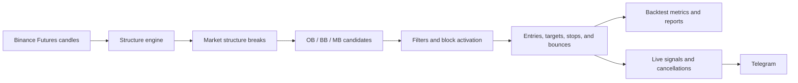

# ST2

ST2 is a Python strategy research and signal publishing project built around market structure breaks (MSBs), order blocks, breaker blocks, and mitigation blocks. It uses Binance Futures candle data to find trading zones, simulate entries and exits, compare parameter combinations, and publish signals to Telegram.

The project has three main entry points:

| Command | Purpose |
| --- | --- |
| `python run_backtest.py` | Run the parameter sweep defined in the script and export results and analysis charts. |
| `python run_forward.py` | Follow live Binance candles, recalculate the strategy, and manage Telegram signals. |
| `python chart.py` | Open the desktop viewer for chart snapshots produced by the forward test. |

ST2 publishes messages for downstream execution tools such as Cornix. It does not place or manage exchange orders itself. Position status is inferred from candle data, rather than read from an exchange account.

## How the strategy works



1. **Detect structure.** Choose the sequential `pine_replay` detector or the `bulk` zigzag and MSB pipeline. `lag` controls swing detection and `fib_factor` controls break confirmation.
2. **Build blocks.** An MSB can produce an order block (`OB`) and a breaker (`BB`) or mitigation (`MB`) block. Each zone uses the full high and low of its base candle.
3. **Validate and activate.** Filter by direction, block type, and percentage height. Optionally reject blocks touched before formation, then wait for price to move beyond the zone before activating it.
4. **Plan positions.** Bullish blocks enter long at their high; bearish blocks enter short at their low. Select one to four targets, equal or weighted exits, fixed or breakeven stops, and optional minimum distances for small blocks.
5. **Simulate and repeat.** Use candle highs and lows to find entry, target, and stop events. A block can generate another entry after the configured target threshold, up to `max_bounces` total attempts.
6. **Report or publish.** Backtests produce combined, long, and short results. Forward testing tracks active signals, suppresses duplicate posts, and cancels eligible signals when their setup disappears.

Read the [strategy guide](docs/strategy.md) and [position guide](docs/positions.md) for formulas, timing rules, and examples.

## Quick start

Run commands from the repository root. The existing development environment uses Python 3.13; use Python 3.13 for a matching setup. The chart source requires Python 3.12 or newer syntax.

```bash
python -m venv venv
```

Activate the environment:

```powershell
# Windows PowerShell
.\venv\Scripts\Activate.ps1
```

```bash
# Linux / macOS
source venv/bin/activate
```

Install dependencies:

```bash
python -m pip install -r requirements.txt
```

Copy [the credentials template](src/init/templates/.env.secret.template) to `.env.secret`, and create `data/symbol_lists/symbols.csv` with one Binance Futures symbol per line and **no header**:

```csv
BTCUSDT
ETHUSDT
```

Review [.env.config](.env.config) for strategy settings and [.env.misc](.env.misc) for service and retry settings. Optional `.env.misc.local` overrides let you set local values such as `dev=True` or a proxy without editing the shared files.

Start a forward test without posting to Telegram:

```bash
python run_forward.py --dry -s symbols.csv -t 15m
```

This still fetches live data and writes signal state and chart snapshots. For a full walkthrough, including credential setup and restarting after a dry run, see [getting started](docs/getting-started.md).

To use a preset, pass its timeframe explicitly:

```bash
python run_forward.py --dry --config env_bat_files/.env.config.btc_1h -s symbols.csv -t 1h
```

The CLI defaults `-t` to `15m` even when the selected configuration file specifies another timeframe. [Configuration precedence](docs/configuration.md#configuration-precedence) explains this and other override behavior.

Before running a backtest, edit `BACKTEST_START_DATE`, `BACKTEST_END_DATE`, `symbols`, and `params_range_dict` in [run_backtest.py](run_backtest.py). The checked-in sweep contains **9,464 combinations**; reduce it for a first run. Dates and sweep ranges are configured in Python, rather than CLI flags.

```bash
python run_backtest.py --backtest_output_dir first_run
```

See [backtesting](docs/backtesting.md) for a small example sweep and the output format.

## Documentation

| Guide | Contents |
| --- | --- |
| [Documentation index](docs/README.md) | Reading paths and links to every guide. |
| [Getting started](docs/getting-started.md) | Installation, local files, first run, presets, and desktop dependencies. |
| [Strategy](docs/strategy.md) | Structure engines, MSBs, block selection, filters, activation, and invalidation. |
| [Positions](docs/positions.md) | Entry levels, all target and stop methods, sizing, profit calculations, and bounces. |
| [Configuration](docs/configuration.md) | Every configuration key, CLI option, precedence rule, preset, and run ID. |
| [Backtesting](docs/backtesting.md) | Sweeps, caching, exports, metrics, scoring, and simulation limits. |
| [Forward testing](docs/forward-testing.md) | Live data synchronization, Telegram, signal eligibility, cancellation, and saved state. |
| [Charts](docs/charts.md) | Live desktop viewer, interactive HTML charts, and analysis reports. |
| [Architecture](docs/architecture.md) | Module responsibilities, data structures, storage, and extension points. |
| [Troubleshooting](docs/troubleshooting.md) | Common configuration, data, signal, and chart issues. |

All guides use relative Markdown links and can be browsed directly on GitHub.

## Repository map

```text
run_backtest.py          Backtest sweep and report orchestration
run_forward.py           Forward-test startup and live loop
chart.py                 Desktop chart entry point
.env.config              Shared strategy settings
.env.misc                Shared runtime and service settings
env_bat_files/           Strategy presets
src/
  config/                Typed configuration and CLI parsing
  data_provider/         Historical data, local cache, and live candles
  logic/                 Structure, blocks, positions, and simulation
  backtest/              Sweeps, metrics, aggregation, and report plots
  forward_test/          Live orchestration, synchronization, and snapshots
  telegram/              Message formatting, state, and Telegram HTTP client
  visualization/         Plotly charts and PyQt6 live viewer
  init/                  Startup checks, templates, and cleanup
  logger/                Console and file logging
docs/                    Detailed guides
```

Generated data lives under `data/klines/`, `data/state/`, and `data/chart/`; reports live under `outputs/`; logs live under `logs/`. These directories are ignored by Git. Backtest `config.json` exports include the entire loaded configuration, including credentials when present; redact those values before sharing a report folder.
