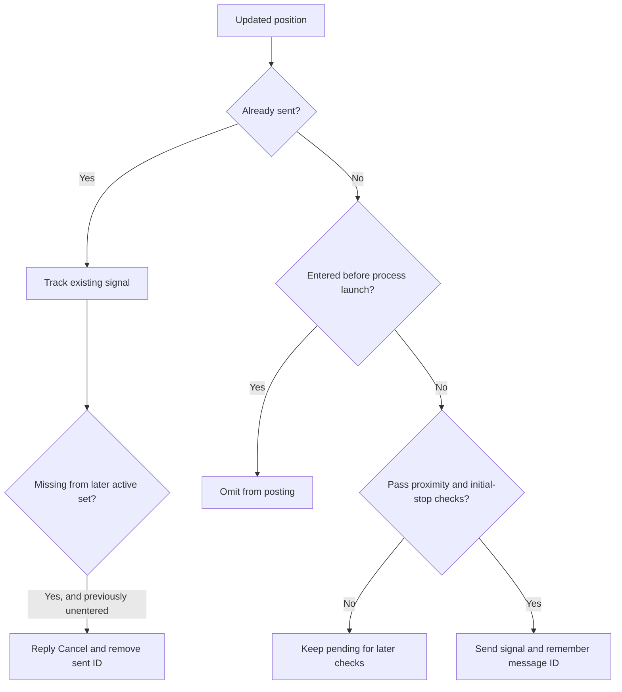

# Forward testing and Telegram signals

[Project README](../README.md) · [Documentation index](README.md) · [Getting started](getting-started.md) · [Configuration](configuration.md)

[run_forward.py](../run_forward.py) follows live Binance Futures candles and manages Telegram signal messages. It calculates hypothetical positions from market data; it does not query exchange balances, fills, or open orders.

## Startup

```bash
python run_forward.py --dry -s symbols.csv -t 15m
```

Normal startup follows this order:

1. Parse CLI arguments and load configuration.
2. Confirm the destination channel, unless `--dry` is set.
3. Clear chart snapshots for this run, and any logs, state, or caches selected by cleanup flags.
4. Create missing directories and template files.
5. Configure logging.
6. Load symbols and saved signal state, fetch history, calculate initial structure and positions, and process initial signals.
7. Start the live tick producer and consumer.

Create `.env.secret` and your symbol CSV before startup. Bootstrap happens after channel confirmation, so its ability to create a credentials template is not a substitute for first-run setup.

`--dry` skips channel lookup and suppresses normal new-signal and reply-cancellation sends. It still constructs clients, downloads data, formats messages, updates state, and writes snapshots. Development mode (`dev=True` in a dotenv file) chooses the development channel and DEBUG logging but still sends messages unless dry mode is enabled.

## Channel selection and confirmation

The [Telegram client](../src/telegram/telegram_client.py) chooses its channel in this order:

1. `--cid`, if supplied.
2. `TG_DEV_CHANNEL_ID` when `dev=True`.
3. `TG_PROD_CHANNEL_ID` otherwise.

The bot must be able to post to the selected channel. Startup calls `getChat` to resolve its title. A failed lookup returning no channel raises a configuration error. Production mode requires `y` or `yes` to proceed; development mode prints the channel and proceeds. An unexpected exception in the startup-check wrapper is printed and can fall through to continuing, so the confirmation step is not an exhaustive health check.

Example with a preset and an explicit channel override:

```bash
python run_forward.py --config env_bat_files/.env.config.btc_1h -s symbols.csv -t 1h --cid -1000000000000
```

Use your actual channel ID in place of the example. For reproducible run-directory identity, use standalone option tokens: the run-ID scanner does not recognize `--option=value`, although argparse accepts it.

## Historical initialization and live synchronization

[ForwardTest](../src/forward_test/forward_test.py) reads the first CSV column, strips it, and uppercases it. Use no header or blank rows. It shares a data provider, tick provider, calculator, Telegram client, and serializer across symbols, with a separate block manager, position manager, and signal manager per symbol.

[DataSyncManager](../src/forward_test/data_sync_manager.py) initially requests `startup_n_days` of history from Binance, including the currently open candle. Unlike historical backtesting, the normal forward path fetches through `BinanceDataProvider` directly and does not use `LocalDataProvider`'s Feather cache.

[BinanceTickProvider](../src/data_provider/live/binance/tick_provider.py) subscribes to combined `<symbol>@kline_<timeframe>` streams. A `Tick` contains the symbol, event time, current price, current candle OHLC, and candle opening timestamp.

- When the timestamp matches the local open candle, its OHLC values are updated in place.
- When a timestamp differs, the sync manager requests enough recent candles to cover the gap plus `binance_cache_resync_buffer`.
- A small gap replaces the overlapping tail and appends the extra latest candle. A gap at least as large as the local history triggers a complete replacement using `startup_n_days`.
- Symbols failing initial history load are removed. If all initial loads fail, startup raises `RuntimeError`. A later resync failure also removes that symbol from processing.

The normal runner always selects live Binance ticks. A `SimulatedTickProvider` exists for programmatic experiments but has no CLI selector in this runner.

## Recalculation and signal lifecycle

The calculator rebuilds structure and simulates positions from active blocks. [SignalManager](../src/telegram/signal_manager.py) compares the resulting positions with the previous set using stable position IDs: block identity plus bounce number.



### Posting eligibility

A position is a posting candidate when its ID has not already been sent and it was not entered before that signal manager's launch time. This last condition avoids publishing already-entered historical setups on startup. It does not categorically reject all entered positions: an entry timestamp after process launch may still pass the current implementation's tests.

Every candidate must pass the initial-stop test:

| Position | Required price condition |
| --- | --- |
| Long | Current price strictly above `stoplosses[0]`. |
| Short | Current price strictly below `stoplosses[0]`. |

If `signal_proximity_check=True`, an additional one-sided proximity test applies. With a threshold of 2%, long signals wait while price is more than 2% above entry; short signals wait while price is more than 2% below entry. This is not a symmetric absolute-distance check.

Candidates failing these current-price checks remain available for future checks. IDs already in the sent mapping are suppressed. The code does not edit a sent message when its calculated levels change, or publish separate target-hit and stop-hit updates.

### Cancellation

A signal becomes outdated when its position ID disappears from the recalculated active-position set. If the previous position object was unentered and its ID has a stored message ID, ST2 replies `Cancel` to that message and removes the mapping. Entered positions are skipped. Cancellation reflects locally inferred status, not an exchange's order state.

The code stores the returned Telegram message ID **plus one**, assuming Cornix reposts the signal with an inline keyboard and that this next message is the one to cancel. This convention depends on the channel's integration. If the reply target is missing and Telegram reports that specific HTTP 400 error, the mapping is removed and the failure is logged.

## Message format and delivery

[MessageTemplate](../src/telegram/message_template.py) includes the symbol, a static exchange list, long/short direction, leverage type and amount, entry, all take-profit prices, and initial stop. Breakeven stop methods add the appropriate target trigger text.

Symbol prices use decimal counts from [data/precisions/precisions.csv](../data/precisions/precisions.csv), keyed without the `USDT` suffix; missing symbols fall back to seven decimals. `XAGUSDT` is displayed as `SILVER(XAG)/USDT`. The exchange list is message metadata; market data still comes from Binance.

When `validation=True`, the message also includes the position ID, block activation time, and timeframe. Target quantity weights are not included in the message, so downstream allocation is independent of simulated weights.

One async send lock serializes messages across symbols. After a successful send, it waits `telegram_api_send_message_delay` seconds before releasing the lock. Retryable network failures use exponential backoff. HTTP errors such as invalid credentials, permissions, or rate-limit responses are raised rather than automatically retried by that retry loop.

## Saved state and restarts

Signal state is stored in `data/state/<run_id>/<SYMBOL>.pickle`. It contains the current position set, first-run status, and sent-ID-to-message-ID mapping. The omitted-position debug set and process launch time are not persisted.

State is saved when posting or cancellation changes the sent mapping, rather than on every candle update. After a restart, stored position snapshots can therefore reflect the last mapping change rather than the latest in-memory position status. Existing sent IDs generally suppress duplicate posts, but this is not a transactional record of external orders.

Dry runs also store simulated sends. They use synthetic message IDs, and because `--dry` is not part of the run ID, switching it off can reuse that state. Use a separate run identity for development or intentionally clear the selected run's state before moving to real publishing. Clearing state can cause eligible setups to be sent again.

Normal startup always clears the selected run's chart files. `--clear_state`, `--clear_logs`, and `--clear_klines` clear their corresponding directories; `--clean` enables all three. None of these flags cancels messages already posted to Telegram. See [run IDs](configuration.md#run-ids-and-local-directories).

## Cancel mode

```bash
python run_forward.py --cancel-mode -s symbols.csv --cid -1000000000000
```

After explicit confirmation, this sends `Cancel SYMBOL` once for every symbol in the CSV, with a five-second pause between symbols in addition to the client's send delay. It closes the Telegram client and exits without loading market data or starting the live loop.

This is a bulk symbol-level message workflow, separate from replies cancelling specific signal IDs. It bypasses the normal channel-confirmation, bootstrap, logging setup, and cleanup path. It does not clear saved signal state. **Its send loop does not check `--dry`**, so combining `--cancel-mode --dry` still sends cancellation messages after confirmation.

## Runtime details that affect observed behavior

The current calculator has one last-calculation timestamp shared across symbols. The first symbol processed within an interval can therefore cause others to skip recalculation until a later opportunity. This also affects initial multi-symbol calculation. Chart writes use `calc_interval`, even though `chart_data_write_interval` exists in the config.

The consumer drains its queue and keeps only the latest queued tick globally, rather than retaining one latest tick per symbol. During slow processing or message delays, some intermediate updates and symbols' updates can be skipped. REST resync repairs candle history when the opening timestamp changes, but this is not a tick-by-tick replay.

The WebSocket listener includes reconnect logic, but it exposes `_listen_error` to its consumer while retrying. That consumer can raise and terminate the run before all configured reconnect attempts finish. Removing symbols also mutates the provider's symbol list; an already-open subscription is not rebuilt immediately.

Historical timestamps are UTC with timezone information removed, while launch-time comparisons use local `datetime.now()`. UTC logging does not change the host's local clock. Running on a UTC-configured host avoids a local/UTC mismatch in the “entered before launch” filter.

Use [charts](charts.md) to inspect snapshots and [troubleshooting](troubleshooting.md) when live behavior does not match your expected settings.
